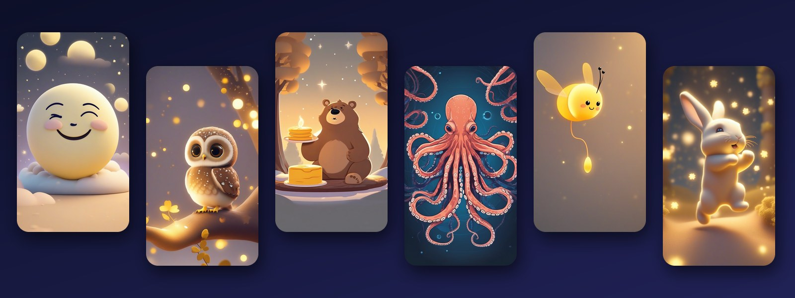
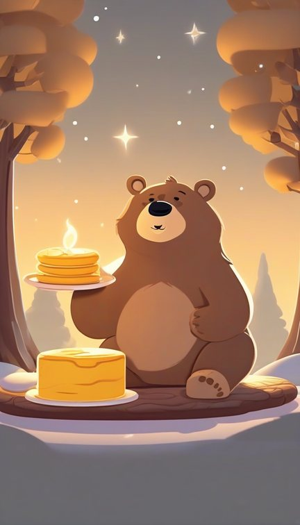
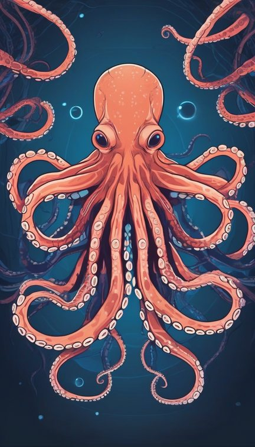
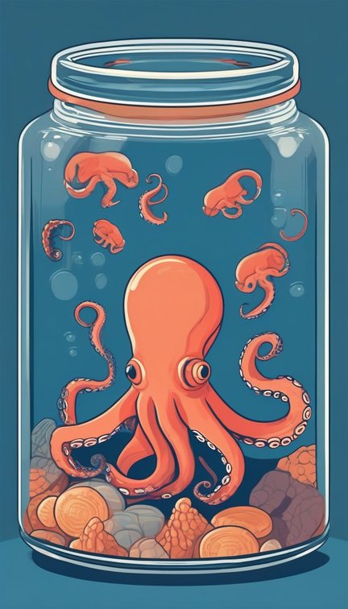
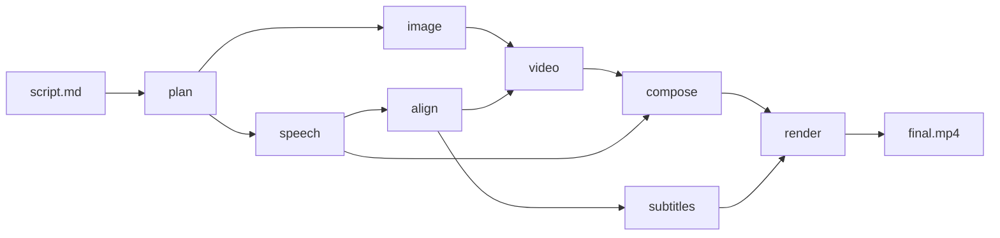
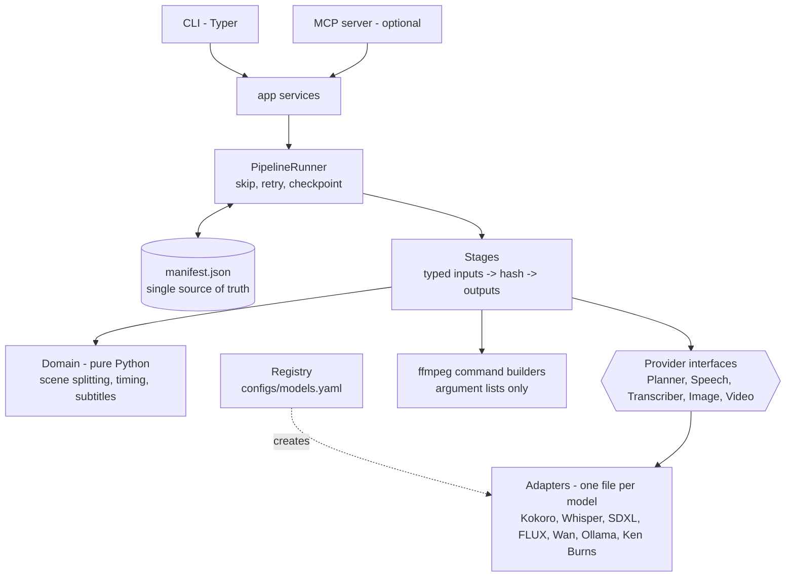

<div align="center">

# shortgen

**Turn a script into a narrated, captioned short video.<br>On your own machine, for free, with one command.**

<p>
  
  
  
  
  
</p>



<sub>Every picture on this page was drawn by shortgen on a 16 GB MacBook Air, three to four and a half minutes each.</sub>

</div>

<br>

You give it a text file. It splits the script into scenes, narrates each one, draws one illustration per scene, animates it, times the captions to the spoken words, and stitches everything into an MP4 with ffmpeg.

```bash
shortgen run examples/story.md
```

By default every model runs on your own machine and nothing calls a paid API. Every stage is resumable: if you stop it, change one sentence, or one scene fails, running the same command again only redoes what is affected.

## See it

<table>
<tr>
<td width="38%" align="center">

</td>
<td>

**The first seconds of a real video.** A 48-second bedtime story, [`stories/moon-night-off`](stories/moon-night-off/script.md): ten scenes, narrated by Kokoro, drawn by Stable Diffusion XL, animated with a slow zoom or pan, with captions timed to the spoken words.

It took about 40 minutes on a 16 GB MacBook Air. Nearly all of that is drawing: everything after the pictures takes under a minute.

The GIF has no sound and is reduced in size and frame rate. The real output is 1080x1920 at 30 frames a second, with audio.

</td>
</tr>
</table>

### You write this, it draws that

A script is plain text. One paragraph is one scene. A comment under a paragraph says what the picture should show, and is never read aloud.

<table>
<tr>
<td>

```markdown
So she pulled a cloud up to her chin,
and went to sleep.
<!-- image: one cute round pale yellow
     full moon character fast asleep,
     eyes closed, a fluffy white cloud
     over it like a blanket -->
```

</td>
<td width="30%" align="center">

</td>
</tr>
</table>

### Gallery

<table>
<tr>
<td align="center" width="25%"><br><sub>Asked for a moon with a sleepy face and a big yawn. Got a smile.</sub></td>
<td align="center" width="25%"><br><sub>Asked for a bear holding one pancake above its head.</sub></td>
<td align="center" width="25%"><br><sub>Asked for one tiny firefly glowing warmly on a dark ceiling.</sub></td>
<td align="center" width="25%"><br><sub>Asked for a little owl on a branch with its beak open.</sub></td>
</tr>
<tr>
<td align="center"><br><sub>Asked for a baby rabbit hopping along a trail of golden sparkles.</sub></td>
<td align="center"><br><sub>Asked for an octopus with glowing nerves in its arms. No nerves.</sub></td>
<td align="center"><br><sub>Asked for an octopus squeezing through a hole in a jar. It sat inside.</sub></td>
<td align="center"><br><sub>Asked for a moon asleep under a cloud like a blanket.</sub></td>
</tr>
</table>

These are the good ones, picked from four real videos. On the way the model also drew a dozen moons where one was asked for, a rabbit with two faces and an owl made of gold. [What it gets wrong](#what-it-gets-wrong) is part of this page on purpose.

> **Status: alpha, and honest about it.** The pipeline, the ffmpeg renderer, the CLI and the MCP server are covered by tests. The default voice (Kokoro) and the default image model (Stable Diffusion XL) have made four complete videos on a 16 GB Apple Silicon Mac. The other model adapters (FLUX, Wan, Whisper, Higgsfield) were written against the published library sources but **have not yet been run for real**. See [What is verified](#what-is-verified) before you rely on it.

## Quick start

You need Python 3.11 or newer and any recent ffmpeg. The stock Homebrew or apt build is fine.

**Try it in a minute, with no model downloads.** This runs the whole pipeline with fake models and the real renderer. The output is colour gradients with a test tone, but it proves your install and ffmpeg work.

```bash
git clone https://github.com/OWNER/shortgen && cd shortgen
python3.12 -m venv .venv && source .venv/bin/activate
pip install -e .
shortgen --config configs/smoke.yaml run examples/story.md
```

**A real video on a Mac (Apple Silicon).**

```bash
brew install ffmpeg

pip install -e ".[speech]"     # real narration now (Kokoro on ONNX Runtime, about 350 MB of weights)
pip install -e ".[local]"      # adds PyTorch and diffusers for SDXL images (several GB)
shortgen doctor                # checks ffmpeg, the device, memory and the models
shortgen run stories/moon-night-off
```

The first real run downloads model weights: about 350 MB for the voice (from the kokoro-onnx GitHub release, checked against a pinned SHA-256) and about 7 GB for SDXL (into the Hugging Face cache). Nothing is bundled in this repository. No Docker is involved: the image model needs the Mac's own graphics chip, which a container cannot reach.

<details>
<summary><b>Linux with an NVIDIA GPU</b></summary>

<br>

```bash
sudo apt install ffmpeg
pip install -e ".[local]"
shortgen doctor
shortgen run examples/story.md
```

With 24 GB of VRAM you can enable neural image-to-video:

```bash
pip install -e ".[video]"
SHORTGEN__PROVIDERS__VIDEO=wan shortgen run examples/story.md
```

Nothing has been run on CUDA yet; see [What is verified](#what-is-verified).

</details>

<details>
<summary><b>A real video with no image model</b></summary>

<br>

The `odyssey-cartoon` example ships with original stick-figure art, so it renders a complete narrated, captioned cartoon using only the voice model and ffmpeg:

```bash
pip install -e ".[speech]"
SHORTGEN__PROVIDERS__IMAGE=folder shortgen run examples/odyssey-cartoon
```

The same `folder` provider lets you bring your own pictures: put `s001.png`, `s002.png`, ... in `<project>/art/`.

</details>

<details>
<summary><b>Optional: hosted pictures and animation (paid, off by default)</b></summary>

<br>

Local models on a 16 GB laptop give you stills with a zoom or pan, not characters that move. If you need that and are willing to pay for it, two optional adapters send each scene to [Higgsfield](https://cloud.higgsfield.ai), a hosted service, for the picture and the animation. They are never a default, they need your own API key, they spend credits per scene, and they **have not been run against the live service**. Everything about them, including what leaves your machine, is in [docs/hosted.md](docs/hosted.md).

```bash
pip install -e ".[hosted]"
export HF_KEY='your-key:your-secret'
shortgen --config configs/higgsfield.yaml run examples/odyssey-cartoon
```

</details>

## How it works



| Stage | What it does | Default |
|---|---|---|
| `plan` | Splits the script into scenes, each with one shot (image prompt, camera move) | Rule-based, no model; optional local LLM via Ollama |
| `speech` | Narrates each scene to a WAV file, with word timings | **Kokoro-82M** (ONNX, no PyTorch needed) |
| `align` | Times every script word against the audio | Kokoro's own timings; an estimate, or Whisper, as fallback |
| `image` | One illustration per scene, with a shared style and optional character descriptions | **Stable Diffusion XL** |
| `video` | Animates each illustration into a clip as long as its narration | Ken Burns zoom or pan via ffmpeg; optional Wan 2.2 |
| `subtitles` | Lays out short captions from the word timings (also saved as SRT and ASS) | No model |
| `compose` | Fits each clip to its narration and muxes them, frame-exact | ffmpeg |
| `render` | Concatenates the scenes and burns in the captions | ffmpeg (captions are drawn with Pillow, so any ffmpeg build works) |

Only two of those are AI models: the voice and the pictures. Speech runs before video on purpose: a clip has to be as long as its narration, so the audio has to exist first.

<details>
<summary><b>Architecture, and the rules that hold it together</b></summary>

<br>



- **The domain is pure Python.** Scene splitting, timing and subtitle layout import no ML library and are unit-tested without a GPU.
- **Stages depend on interfaces, never on a model.** Adding a model is one adapter file plus one entry in `configs/models.yaml`. The pipeline does not change. See [docs/adding-a-model.md](docs/adding-a-model.md).
- **A unit of work reruns only when the hash of its inputs changes.** Inputs include the content hashes of upstream files, so a regenerated image invalidates its clip and nothing else.
- **One model in memory at a time.** Providers load lazily, on first use within a stage, and are unloaded when the stage ends.
- **Ctrl+C is safe.** Outputs are written to temp files and renamed on success; the manifest is written atomically before and after every unit.
- **ffmpeg is the only renderer**, driven through argument lists that are built by pure, tested functions.

Every design decision and deviation is in [docs/architecture.md](docs/architecture.md).

</details>

## Using it

```bash
shortgen run story.md                 # everything; creates projects/story/
shortgen run story.md                 # again: resumes, or does nothing if up to date
shortgen run --topic "why lighthouses blink" --project projects/blink   # needs an LLM planner

shortgen init projects/demo --script story.md --aspect 16:9
shortgen plan projects/demo
shortgen generate projects/demo --stage image --scene s003     # draw one scene
shortgen render projects/demo
shortgen status projects/demo         # what is done, stale, failed or blocked
shortgen doctor

shortgen run stories/moon-night-off   # a folder with script.md + config.yaml is a project
```

The video lands in `<project>/output/final.mp4`, with `subtitles/captions.srt` beside it for upload forms.

### Changing one picture

Edit the `image:` line under that scene and run the same command again. Only that scene is redrawn; the voice and every other picture are kept. The same description always gives the same picture, so to get a different one, change the words.

```markdown
Meet Odysseus, king of a small island called Ithaca.
<!-- image: a bearded Greek warrior in a bronze helmet on a small green island, calm sea, morning sky -->
<!-- camera: zoom_in -->
```

`motion:` and `camera:` (`static`, `zoom_in`, `zoom_out`, `pan_left`, `pan_right`, `pan_up`, `pan_down`) work the same way. Without an `image:` line the narration itself is the picture prompt, which is rarely a good description of a picture. With `providers.planner: ollama`, a local LLM writes these descriptions for scenes that have none.

### Configuration

All defaults live in one file, [configs/default.yaml](configs/default.yaml). Override them, later wins, with `<project>/config.yaml`, then `--config file.yaml`, then environment variables of the form `SHORTGEN__SECTION__KEY=value` (also read from a git-ignored `.env`).

```yaml
# projects/demo/config.yaml
project:
  aspect: "16:9"
  style: "flat vector illustration, bold shapes, limited palette"
providers:
  planner: ollama            # better image prompts from a local LLM
characters:
  - name: Mira
    description: a young lighthouse keeper with a red scarf   # added to every scene that names her
```

### Driving it from an AI assistant (MCP)

```bash
pip install -e ".[mcp]"
shortgen-mcp          # stdio server with tools: init_project, plan, generate, render, run, status, doctor
```

The MCP tools call the same functions as the CLI. There is no second implementation.

## Examples and stories

`examples/` holds five ready-made projects in formats that are common for faceless short-form video. Each is a folder with a `script.md` and a `config.yaml` that sets the look, the voice, the pacing and the caption style.

| Example | Format | Shape |
|---|---|---|
| `odyssey-cartoon` | Cartoon myth explainer, one-line captions (ships with art) | 16:9 |
| `mona-lisa-heist` | True-story heist explainer, paper-collage look | 16:9 |
| `octopus-facts` | "Did you know" facts, big upper-case captions | 9:16 |
| `midnight-knock` | Scary storytime, slow low voice | 9:16 |
| `stoic-morning` | Motivation, centred captions | 9:16 |

`stories/` holds nine more scripts written to be posted: a space fact, an unsolved mystery, an animal fact, a reflection, an original horror story, a piece of strange history and three stories for young children. They were written after the first real runs of the image model, around what it draws well. [stories/README.md](stories/README.md) has suggested titles and descriptions, the sources for every fact, and what YouTube's rules say about AI-made Shorts.

`scripts/e2e.py` renders every example, times every stage and checks each result: resolution, exact frame count against the timeline, audible audio, caption text, caption burn-in, and that a second run does no work. It writes `e2e-runs/report.md` plus a contact sheet per video.

```bash
python scripts/e2e.py                  # with the configured models (SDXL images)
python scripts/e2e.py --images demo    # no image model: bundled art or labelled placeholders
```

## Hardware

| Machine | Default pipeline (SDXL + Ken Burns) | Wan 2.2 image-to-video |
|---|---|---|
| MacBook Air M4, 16 GB | **Works, measured:** 3.8 minutes per picture on average at 24 steps (20 pictures; most took about 3), 4.4 at 30 steps (7 pictures). A ten-scene short takes about 40 minutes, and the laptop gets hot | Not expected to fit |
| Linux, NVIDIA 12 GB | Expected to fit, not yet measured | Not expected to fit |
| Linux, NVIDIA 24 GB | Expected to fit, not yet measured | Model card says 24 GB is enough; not yet measured |
| CPU only | Works, with a warning; images will take many minutes each | No |

The measurements, and the estimates for everything not yet measured (labelled as estimates), are in [docs/hardware.md](docs/hardware.md).

## What it gets wrong

Four real videos showed the limits clearly, and they are not small.

- **The pictures do not move.** On a 16 GB machine the "animation" is a slow zoom or pan over a still. Real motion needs a 24 GB GPU (Wan, not yet run) or a paid hosted service (Higgsfield, not yet run).
- **The model draws the subject and drops the detail.** Asked for an octopus with three hearts inside its body, it drew a handsome octopus. Asked for a yawn, it drew a smile.
- **Words leak.** A style that said "infographic poster" produced fake text. "Golden sparkles" near an owl turned the owl gold. "A night sky full of stars" produced a dozen moons.
- **A character changes from picture to picture.** Each scene is drawn from scratch. A fixed description under `characters:` helps; it does not make two pictures of the same owl identical.
- **Some pictures are simply wrong**, and now and then one is odd in a way you would not want to publish. Look at every picture before you post a video, above all one meant for children.
- **It is slow.** Three to four minutes per picture, each time you change one.

Getting a good video took two or three rounds of rewording for every story so far. What worked is written down in [stories/README.md](stories/README.md).

## What is verified

| Part | State |
|---|---|
| Domain logic, config, registry, manifest, runner | Unit-tested |
| Resume, selective regeneration, failure isolation, retry, Ctrl+C safety, one-model-at-a-time | Tested end to end with fake providers |
| ffmpeg rendering (Ken Burns, compose, concat, caption burn-in) | Tested with real ffmpeg 6.1 and 4.4 on Linux; frame counts checked against the timeline. Needs no libass |
| Kokoro speech on ONNX Runtime (`kokoro_onnx`), with word timings | **Run for real** on Linux x86-64 and on an Apple Silicon Mac, across more than a dozen complete videos, all with measured word timings; and on Linux arm64 for one narration |
| The five example formats end to end (`scripts/e2e.py --images demo`) | All pass every check, with the real voice and bundled art or placeholders standing in for the image model |
| CLI and MCP server | Tested against the fake pipeline |
| Ollama planner | Tested against a local stub of Ollama's API, not a real Ollama |
| SDXL image adapter (`sdxl`) | **Run for real** on a 16 GB Apple Silicon Mac: four complete videos (`octopus-facts`, `one-light-day`, `pip-the-owl`, `moon-night-off`), about 50 pictures at 768x1344. Reference images (IP-Adapter) and CUDA have not been run |
| FLUX, Wan, Kokoro (PyTorch), faster-whisper, mlx-whisper adapters | **Not run against real weights.** Tested only against stand-ins for the libraries |
| Higgsfield adapters (optional, hosted, paid) | **Not run against the live service** (no account). Tested against the real `higgsfield-client` library talking to a pretend server; model ids and argument names come from published examples. See [docs/hosted.md](docs/hosted.md) |
| macOS | Four complete real runs on an Apple Silicon Mac with Homebrew ffmpeg: voice, SDXL pictures, animation, burned-in captions and the final render all worked. The test suite ran there once before the libass fix (everything else passed) and has not been re-run since |
| CUDA | **Not run** |

## Roadmap

- Real character animation. Today a 16 GB machine gets zoom and pan over stills.
- A character that stays the same across scenes: run and measure the reference-image path (IP-Adapter).
- Background music with automatic ducking under the narration.
- Word-by-word caption highlighting (the timings are already there).
- Run and measure every other adapter on an NVIDIA GPU; replace the estimates in `docs/hardware.md` with numbers.
- An MLX image adapter for faster generation on Apple Silicon.
- A lighter image-to-video option that fits in 16 GB.
- Multiple shots per scene.
- Per-step progress inside long diffusion runs.
- Cleaning up files left behind when a re-plan removes scenes.

## Why I built this

I wanted to make short narrated videos from my own scripts without paying per clip, and without sending the scripts to anyone's server. The tools I found were either hosted, or a notebook that worked once and could not be resumed when it crashed at scene nine of twelve.

Video generation on a laptop is slow, so the part that matters most is not the models. It is being able to stop, change one sentence, and not lose an hour of work. That is what this project is mostly about: a small, boring, well-tested pipeline around models that you can swap.

It will not make a film. On a 16 GB MacBook the default "animation" is a slow zoom or pan over a still image, because that is what such a machine can do reliably today. If you have a 24 GB GPU you can switch on a real image-to-video model with one line of config.

## License

**Code:** [Apache-2.0](LICENSE).

**Models:** not part of this repository and not covered by its license. Each model's weights are downloaded from its publisher under that publisher's terms. The registry, [configs/models.yaml](configs/models.yaml), records the license of every model shortgen can use, and [docs/licenses.md](docs/licenses.md) lists them in one table with whether commercial use is allowed. Every model enabled by default permits commercial use, and `shortgen doctor` warns if you select one that does not. Licenses change, so check the linked model card before you publish or sell anything.

**Pictures on this page:** drawn by Stable Diffusion XL through shortgen, from this repository's own scripts.

**Hosted services:** the optional Higgsfield adapters are governed by Higgsfield's own terms and pricing, which this project has not reviewed. They are off by default.
