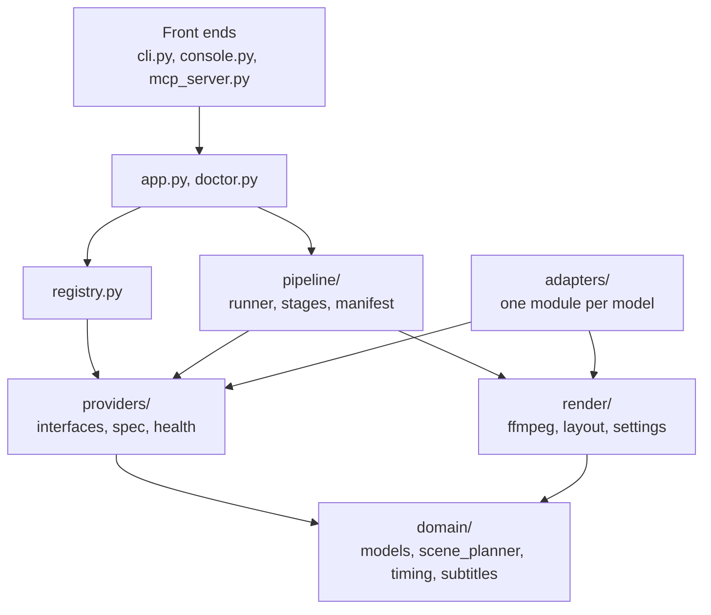

# Architecture

This document explains how shortgen is put together and records every design decision, including where it deviates from the original brief.

## The dependency rule

Imports only point inward. Nothing in an inner layer knows an outer layer exists.

`adapters/` is never imported by the pipeline. The registry imports an adapter module by name, and only when the configuration selects it. Heavy libraries (torch, diffusers, kokoro) are imported inside an adapter's `load()`, so `import shortgen` and `shortgen status` are instant and work without them.

## Modules

| Module | Responsibility |
|---|---|
| `domain/models.py` | Pydantic contracts: `Project`, `Scene`, `Shot`, `Asset`, `Timing`, `WordTiming`, `Job` |
| `domain/scene_planner.py` | Deterministic script splitting, enrichment overlay, prompt assembly |
| `domain/timing.py` | Scene durations, the timeline, aligning recognised words onto script words |
| `domain/subtitles.py` | Cue grouping, line wrapping, SRT and ASS serialisation |
| `config.py` | Layered YAML + environment overrides, validated once into `AppConfig` |
| `providers/interfaces.py` | The five abstract providers and their request models |
| `providers/spec.py` | `ModelSpec`: the schema of a `models.yaml` entry |
| `providers/health.py` | Dependency, device and weight-cache checks |
| `registry.py` | Maps names to adapter classes; builds providers and fingerprints |
| `adapters/*` | All model-specific code: loading, device choice, memory release |
| `pipeline/hashing.py` | Stable hashes of models and files |
| `pipeline/workspace.py` | Project directory layout, path validation, atomic writes |
| `pipeline/manifest.py` | The manifest model and its atomic store |
| `pipeline/contracts.py` | Typed inputs of each stage and the JSON artefact schemas |
| `pipeline/stage.py` | `Stage`, `WorkUnit`, `Targets` (temp outputs), `ProviderHandle` (lazy load) |
| `pipeline/stages.py` | plan, speech, align, image, video, subtitles |
| `pipeline/render_stages.py` | compose, render |
| `pipeline/runner.py` | Freshness checks, retry, failure isolation, checkpointing |
| `render/ffmpeg.py` | Pure builders that turn typed specs into ffmpeg argument lists |
| `render/captions.py` | Rasterises cues to transparent PNGs with Pillow and writes the timeline ffmpeg overlays |
| `render/layout.py` | Frame geometry: size fitting, clip fitting |
| `process.py` | The one place a subprocess is started |
| `device.py` | CUDA / MPS / CPU detection and memory facts |
| `app.py` | Application services used by both front ends |
| `doctor.py` | Environment diagnosis |
| `cli.py`, `console.py` | Typer commands and terminal rendering |
| `mcp_server.py` | Optional MCP tools that call `app.py` |

## Stage contracts

Each stage is a list of *units* (one per scene, or one for the project). A unit has typed inputs, which are hashed, and declared output files.

| Stage | Scope | Inputs that are hashed | Outputs |
|---|---|---|---|
| `plan` | project | script or topic, planning rules, characters, seed, planner fingerprint | scenes stored in the manifest |
| `speech` | scene | narration, voice, speed, language, speech fingerprint | `audio/sNNN.wav`, `audio/sNNN.words.json` |
| `align` | scene | narration, hash of audio, hash of native words, transcriber fingerprint | `alignment/sNNN.json` |
| `image` | scene | full prompt, negative prompt, target size, seed, reference image hashes, hash of a supplied picture (folder provider), image fingerprint | `images/sNNN.png` |
| `video` | scene | hash of image, motion prompt, camera, scene duration, fps, size, seed, video fingerprint | `clips/sNNN.mp4` |
| `subtitles` | project | hashes of all alignments, timing rules, subtitle rules and style, size, fps | `subtitles/captions.json` (burned in), `captions.srt`, `captions.ass` (sidecars) |
| `compose` | scene | hashes of clip and audio, duration, audio offset, size, fps, encoder settings | `build/sNNN.mov` |
| `render` | project | hashes of all segments, hash of the cue sheet, caption style, encoder settings | `output/final.mp4` |

A *fingerprint* is the provider's registry name, adapter path, model ID and merged options. Changing a model or one of its options therefore invalidates exactly the stage that uses it.

## Resumability

A unit is **fresh** when its job in the manifest is `done`, the stored inputs hash equals the current one, and every output file still exists. Fresh units are skipped. Everything else follows from that one rule:

- Re-running after a crash continues where it stopped.
- Editing one paragraph re-plans, then regenerates only the scenes whose narration changed.
- Changing the subtitle style redoes `subtitles` and `render`, and nothing else.
- Deleting an output file regenerates it. If the result is byte-identical, nothing downstream reruns.
- `--force` reruns the selected units regardless.

When only some stages are selected and an earlier, unselected stage is out of date, the runner warns that downstream stages will use its previous outputs.

## Failure handling

- **Isolation.** A failed unit is recorded in the manifest with its error and the stage carries on with the other scenes. After the stage, the pipeline stops with a `StageFailedError` naming the failed scenes. Re-running retries only those.
- **Retry.** Only `TransientError` is retried, with bounded exponential backoff (`runtime.max_attempts`, `backoff_base_s`, `backoff_max_s`). Deterministic failures are not retried, because retrying an out-of-memory error only wastes time.
- **Unavailable providers.** A `ProviderUnavailableError` (missing dependency, server not running) stops its stage immediately instead of failing once per scene.
- **Nothing is swallowed.** The runner catches broadly at exactly one place, logs the traceback, records the error in the manifest and reports the failure.

## Interruption safety

- A stage never writes to a final path. `Targets` hands it sibling temp paths (`s001.partial.mp4`); only after the whole unit succeeds are they renamed into place and hashed. A killed process leaves at most a `.partial` file, which the next attempt removes.
- The manifest is written with temp file + `fsync` + atomic rename, before and after every unit.
- On Ctrl+C the running child process (ffmpeg) is terminated, the unit is marked `interrupted`, the provider is unloaded, and the CLI exits with status 130.
- A hard kill (`SIGKILL`, power loss) can leave a job marked `running`. That is harmless: it is not `done`, so it reruns.

## Memory

- Providers are created cheaply and loaded lazily through `ProviderHandle`, on the first request of a stage. A stage with nothing to do never loads its model. The align stage only loads a transcriber if a scene has no native word timings.
- `ProviderHandle.close()` runs in a `finally` block at the end of every stage and calls `unload()`, which drops the model and empties the CUDA/MPS cache.
- Because stages run strictly one after another, at most one model is in memory. A test asserts this by recording load and unload events.
- ffmpeg stages need no model memory.

## Security basics

- The default pipeline has no secrets: nothing it uses is paid or hosted. The optional Higgsfield adapters need an API key, which is read only from the environment or the git-ignored `.env`, is handed to adapters through `ProviderContext.env`, and is never written to the manifest, the logs, a stage hash or `doctor` output.
- Output URLs returned by a hosted service must be `https://`, downloads are size-capped, and a downloaded image is decoded and re-encoded before it is used.
- Subprocesses are started only in `process.py`, always from an argument list, never through a shell.
- No user-controlled text is placed in an ffmpeg filter graph. Captions are not drawn by ffmpeg at all: they are rasterised to PNGs by Pillow and composited with `overlay`, so neither caption text nor any path appears inside a filter. The caption timeline lists only file names this program chose.
- Model files fetched outside the Hugging Face cache (the Kokoro ONNX files) come from a pinned HTTPS URL and are verified against a pinned SHA-256 before use.
- Codec and preset names from configuration must match `^[A-Za-z0-9_]+$`.
- Paths stored in the manifest are resolved against the project directory and rejected if they escape it. Script and reference-image inputs must be existing regular files with an expected extension.
- In the ASS sidecar file, caption text has override braces stripped, so a script cannot inject styling tags.
- The Ollama host must be an `http(s)://host[:port]` URL.

## Decisions and deviations from the brief

1. **Speech runs before video.** The brief lists images, video, then narration. A clip must be as long as its narration, so the audio (and its measured length) has to exist first. The order is plan, speech, align, image, video, subtitles, compose, render.
2. **The default animator is a Ken Burns zoom/pan, not a neural model.** Wan 2.2's model card asks for a 24 GB GPU, which rules out the 16 GB MacBook target. A `VideoGenerator` adapter built on ffmpeg's `zoompan` keeps the default pipeline runnable everywhere. Wan is one config line away.
3. **The default planner is rule-based, not an LLM.** It needs no download and is deterministic. The Ollama planner is opt-in. In both cases narration is a verbatim slice of the script: the LLM only writes image prompts, motion prompts and camera moves for scenes that were already cut deterministically. This guarantees that captions match the audio.
4. **One shot per scene.** The brief asks for "a shot list"; v1 models that as exactly one `Shot` per `Scene`. Multiple shots per scene is on the roadmap.
5. **Alignment is its own stage.** Kokoro returns word timestamps for English, in which case no transcriber is loaded. For other voices the transcriber's words are mapped back onto the script's words with a sequence matcher, so captions always show the script's spelling.
6. **Two rendering stages.** `compose` makes one segment per scene (resumable, per-scene), `render` concatenates and burns captions. Segments are H.264 with PCM audio in a `.mov` container and are capped by frame count, so each is exactly as long as the timeline says. A test verifies the final frame count against the timeline.
7. **Scene durations are rounded up to whole frames** to make point 6 possible.
8. **Extra modules beyond the suggested layout**, each because it has one clear job: `app.py` (shared services so the CLI and MCP cannot diverge), `doctor.py`, `console.py`, `process.py`, `media.py`, `pipeline/stage.py`, `pipeline/contracts.py`, `pipeline/render_stages.py`, `pipeline/catalog.py`, `pipeline/workspace.py`, `pipeline/retry.py`, `pipeline/progress.py`, `pipeline/context.py`, `render/settings.py`, `providers/spec.py`, `providers/health.py`.
9. **Defaults live in `configs/` at the repository root and are packaged into the wheel** (`shortgen/_configs`) by the build. A source checkout reads `configs/` directly, so there is one copy to edit.
10. **Adapter options have no defaults in code.** Every number an adapter uses is in `configs/models.yaml`, and each adapter validates its options with a Pydantic model whose fields are required.
11. **Environment overrides use a double underscore** (`SHORTGEN__RENDER__FINAL__CRF`) so that keys containing single underscores stay unambiguous.
12. **Adapters ask for a target frame, not a pixel size.** Each adapter derives its own native size from a pixel budget (`max_area`) and a size multiple, as the reference pipelines do.
13. **The MCP server targets MCP Python SDK 2.x**, where `FastMCP` was renamed `MCPServer`. Expected failures are re-raised as `ToolError`, because the SDK hides the message of any other exception from the assistant.
14. **Kokoro runs on CUDA or CPU, not MPS.** The model is 82M parameters and faster than real time on a CPU; using MPS would require setting a process-wide PyTorch fallback variable.
15. **Fake providers ship in the package**, not only in the tests. They make `make smoke` and `configs/smoke.yaml` possible: the full pipeline with the real renderer in seconds.
16. **No database, no job queue.** One JSON manifest per project is the source of truth, as the brief asks.
17. **Captions are drawn by Pillow, not by ffmpeg.** The first version used ffmpeg's `ass` filter, which needs libass; Homebrew's default ffmpeg does not have it, so the final stage failed on a stock Mac. ffmpeg is still the only renderer in the sense that it does all compositing and encoding, but text rasterisation happens in `render/captions.py`. This makes Pillow a core dependency and removes every requirement on how ffmpeg was built.
18. **The default voice is Kokoro on ONNX Runtime.** It needs no PyTorch, works on Python 3.13, and is the one real model that has been run end to end. Its phoneme timings do not map one-to-one onto written words (the phonemiser fuses "on the" and expands "2026"), so `domain.timing.assign_spans` pairs them with a small dynamic-programming alignment.
19. **The default transcriber is the proportional estimator.** With Kokoro's own timings it is never used; keeping it as the fallback means the default pipeline has no second speech model to install.
20. **A project is a folder.** A directory holding `script.md` (and optionally `config.yaml` and `art/`) becomes a project in place on its first run. That is how the bundled examples work.
21. **Bring-your-own images are a provider** (`folder`), not a special case. It reports the hash of the supplied file through `ImageGenerator.source_fingerprint`, so swapping one picture regenerates one scene.
23. **Picture descriptions live in the script.** A paragraph can carry `<!-- image: ... -->`, `<!-- motion: ... -->` and `<!-- camera: ... -->` comments. They are parsed by the deterministic planner, never narrated, and win over an LLM planner's suggestions. This keeps good prompts possible with no LLM installed.
24. **Hosted adapters exist, and are fenced off.** The brief allows optional paid adapters that are off by default; `higgsfield_image` and `higgsfield_video` are the only ones. A registry entry declares `hosted: true`, a test fails if any default provider is hosted, `doctor` warns whenever one is selected, and the adapter logs a warning when it loads. Because each job costs money, these adapters depart from the usual retry rule: a job that was accepted is never resubmitted. Its request id is kept in a small ledger keyed by the job's inputs until the output is on disk, so a retry, a crash or Ctrl+C picks the same job up again. Only a failure to connect counts as transient. `commercial_use` may be `null` for such entries, meaning the service's terms decide and were not checked.
22. **Captions break at clauses** (commas, colons, dashes) as well as sentences, and a caption never ends on a dangling "a", "the" or "of" when the next one has room for it.

## Known gaps in the design

- When a re-plan produces fewer scenes, the files and manifest entries of the removed scenes are left behind. They are ignored, not deleted.
- Progress is reported per unit. A single long diffusion run shows no inner progress.
- SDXL's text encoders read 77 tokens. A long narration used directly as the image prompt (the rule-based planner) can push the style keywords past that limit; the Ollama planner writes short prompts and avoids it.
- With several reference images in one scene, SDXL uses only the first.
- mlx-whisper has no public unload call; the adapter clears a private cache and says so in a comment.
